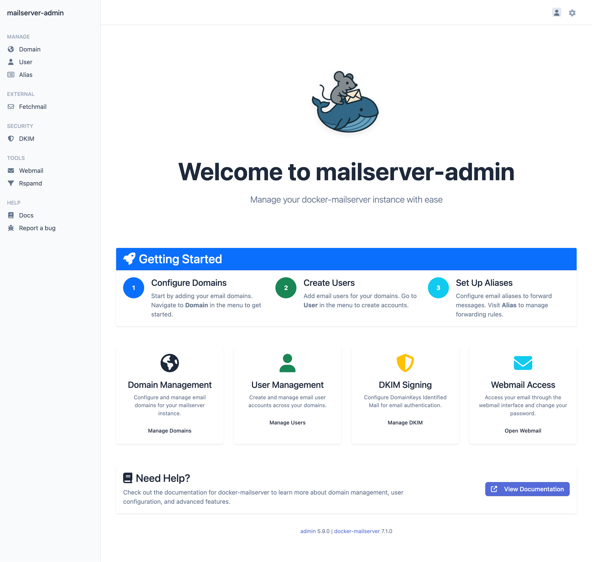

# Dashboard

The dashboard is the main page after login. It shows an overview of the mailserver: domains, users, and quick links to common tasks.

The menu leads to domain, user, alias, fetchmail and DKIM management, the [DNS Validation Wizard](../how-to/validate-dns.md) and the [observability dashboards](../explanation/observability.md). Entries depend on the [role](../reference/user-roles.md) of the logged-in user.
