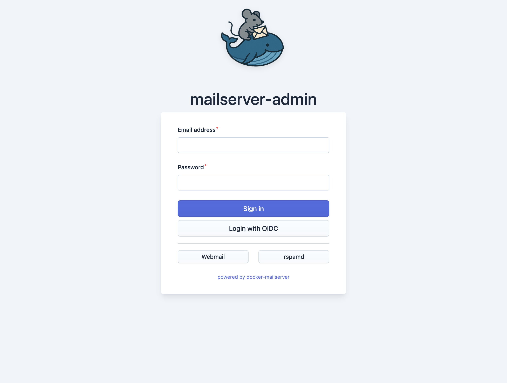

# Login

The login page authenticates users to the mailserver-admin interface. Authentication methods are local (email + password) or OAuth2, depending on configuration.

## Authentication methods

### Local authentication

By default, users log in with their mailserver email address and password.

### OAuth2

When OAuth2 is enabled, an OAuth2 login button is shown and users sign in through an external identity provider. For setup, see [How to configure OAuth2](../how-to/configure-oauth2.md).
