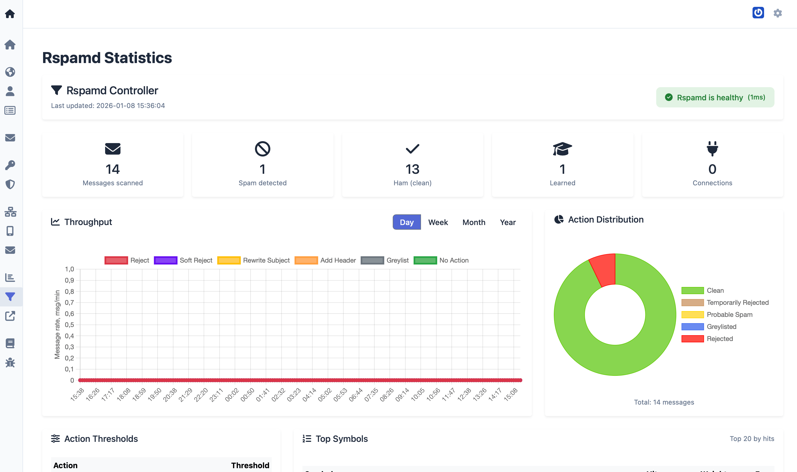
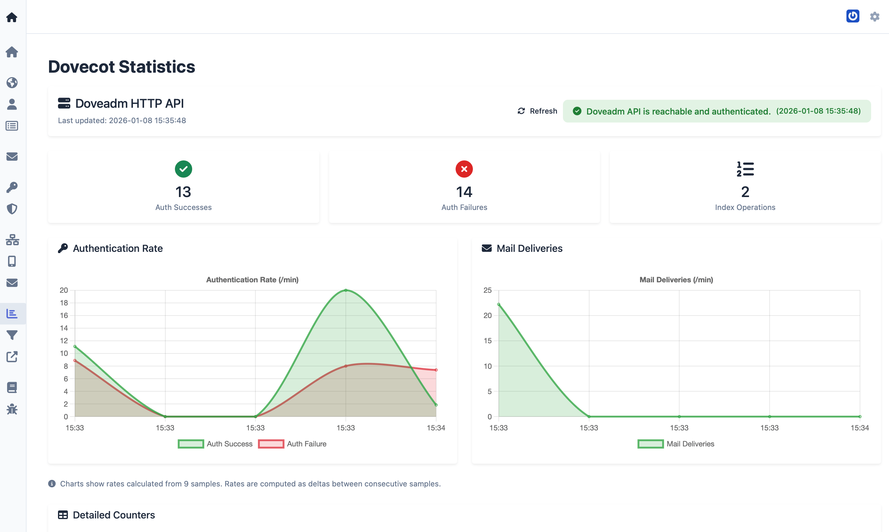

# About Observability

mailserver-admin aggregates data from the Rspamd filter and the Dovecot MDA and presents it in web-based dashboards, so operators can check service health, message throughput, spam filtering results and authentication patterns in one place.

## What the dashboards show

- **Rspamd Statistics:** Health of the Rspamd controller, message counts (scanned, spam, ham, etc.), throughput over time, action distribution (reject, greylist, clean, etc.), and configuration details such as thresholds and top symbols. This helps you see how much mail is being processed and how the filter is behaving.

- **Dovecot Statistics:** Connection to the Dovecot API (Doveadm HTTP), authentication successes and failures, index operations, authentication rate over time, and mail delivery rate over time. This helps you spot authentication issues or unusual delivery patterns.

Data is collected from consecutive samples; rates are computed as deltas between measurements. The dashboards support different time ranges (day, week, month, year) for throughput and rate charts.

The dashboards confirm that Rspamd and Dovecot are reachable, show changes in message volume or filter actions, and show spikes in authentication failures.

The `web` service must be able to reach the Rspamd controller and the Dovecot Doveadm HTTP API. The variables are `FILTER_WEB_ADDRESS`, `CONTROLLER_PASSWORD`, `MDA_DOVEADM_ADDRESS` and `DOVEADM_API_KEY`, see the [environment variables reference](../reference/environment-variables.md).

