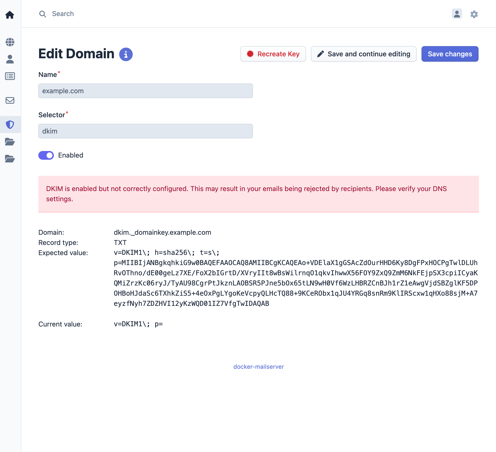

# How to Configure DKIM Signing

DKIM (DomainKeys Identified Mail) signs outgoing mail so receiving servers can verify authenticity. Configure it per domain in the management interface.

## Steps

1. Log in to the management interface.
2. Open **DKIM** in the menu.
3. Select the domain.
4. Generate the private key (if not already done).
5. Add the displayed DNS TXT record to your domain’s DNS. See [DNS records reference](../reference/dns-records.md) for DKIM format.
6. In the management interface, verify the DNS record (e.g. via the DNS Validation Wizard).
7. Enable DKIM signing for the domain.

After this, outgoing mail for that domain is signed.

Rspamd signs only while the published record matches the key, see [DKIM record](../reference/dns-records.md#dkim-record-txt).
