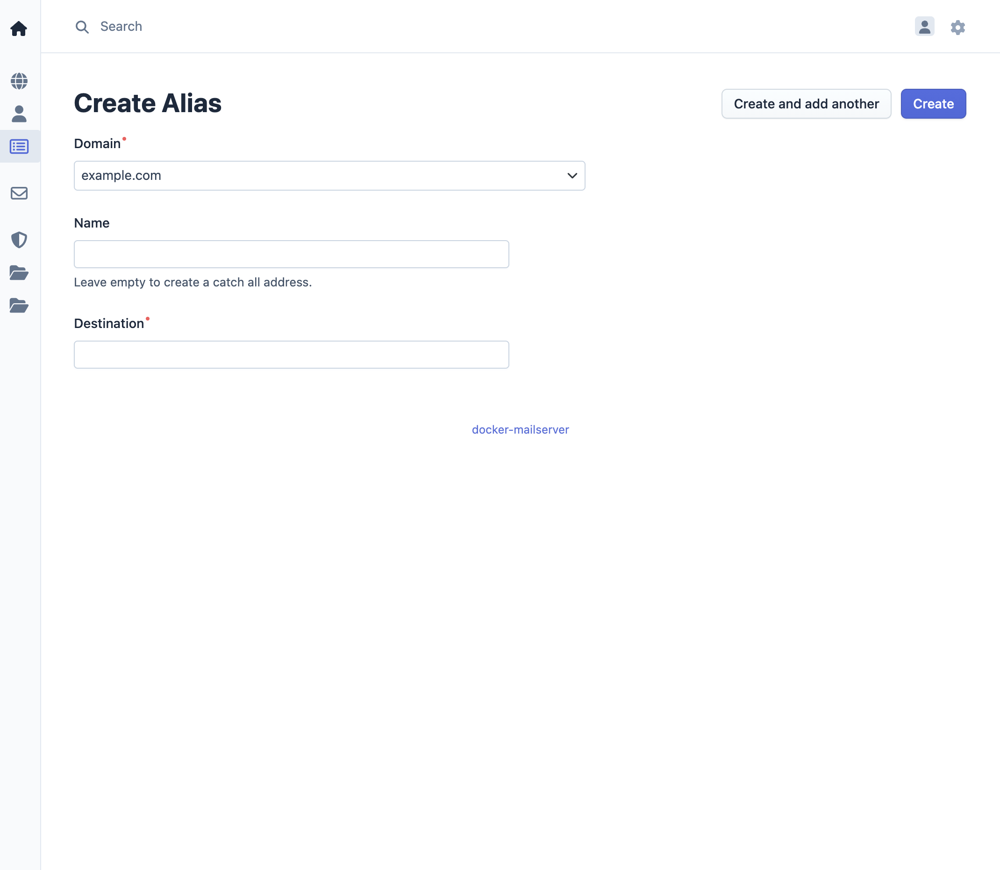

# How to Manage Aliases

Aliases forward incoming mail from one address to a destination (a local user or an external address). Which roles can manage which aliases is listed in the [User roles reference](../reference/user-roles.md); domain admins cannot change aliases on or pointing to an admin's address, see [Protections for admins](../reference/user-roles.md#protections-for-admins).

## Add an alias

1. Log in to the management interface.
2. Open **Alias** in the menu.
3. Click **Add Alias**.
4. Enter:
   - **Source Address:** Local part + domain (e.g. `info@example.com`). Leave the local part empty for a catch-all alias.
   - **Destination Address:** The address to forward to.
5. Save.

The source must belong to an existing domain. The destination can be a local user or an external address. An alias has one destination: create one alias per destination with the same source to forward to several recipients.

## Edit an alias

1. Open **Alias** in the menu.
2. Select the alias.
3. Change source or destination.
4. Save.

## Delete an alias

1. Open **Alias** in the menu.
2. Select the alias.
3. Confirm deletion.

Deleting an alias only removes the forwarding rule; it does not delete user accounts or mail.

## Examples

- Generic addresses: `info@example.com` → `team@example.com`.
- Personal: `john.doe@example.com` → `john.doe@gmail.com`.
- Distribution: two aliases from `announcements@example.com`, one to `user1@example.com` and one to `user2@example.com`.
