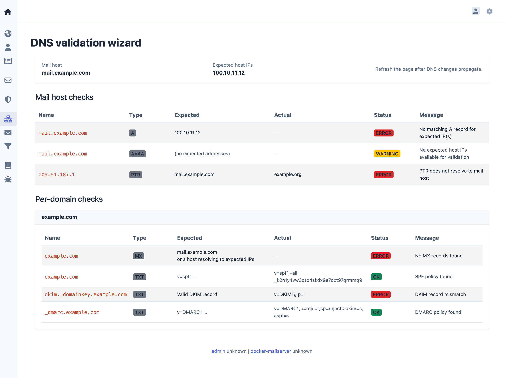

# How to Validate DNS with the Wizard

The DNS Validation Wizard in the management interface checks that MX, SPF, DKIM, and DMARC records for your domain are correctly configured.

## Steps

1. Log in to the management interface.
2. Open the DNS Validation Wizard (e.g. from the dashboard or menu).
3. Select the domain to check.
4. Review the validation result for each record type.

The wizard shows which records are correct and which need attention. Fix any failures in your DNS and run the wizard again.

If the wizard fails right after you changed records, wait for [propagation](configure-dns.md#verification) and run it again. For record types and formats, see the [DNS records reference](../reference/dns-records.md); for setup, see [How to configure DNS for your domain](configure-dns.md).
